# Project_template

Это шаблон для решения проектной работы. Структура этого файла повторяет структуру заданий. Заполняйте его по мере работы над решением.

# Задание 1. Анализ и планирование

<aside>

Чтобы составить документ с описанием текущей архитектуры приложения, можно часть информации взять из описания компании и условия задания. Это нормально.

</aside>

### 1. Описание функциональности монолитного приложения

> **Задание.** Изучите функциональность монолитного приложения:
>
> - **Управление отоплением.** Пользователи могут удалённо включать/выключать отопление в своих домах.
> - **Мониторинг температуры.** Система получает данные о температуре с датчиков, установленных в домах. Пользователи могут просматривать текущую температуру в своих домах через веб-интерфейс.

**Ответ.** Ниже перечислено, что реализовано сейчас, и дана оценка сильных и слабых сторон каждой функции.

| Функция | Что реализовано | Сильные стороны | Слабые стороны и ограничения |
|---|---|---|---|
| Управление отоплением | Удалённое включение и выключение отопления через веб-интерфейс; сервер отправляет команду модулю | Закрывает базовую потребность пользователя; простая и понятная бизнес-логика; минимальный набор состояний | Только бинарное состояние: нет целевой температуры, расписаний и сценариев; нет других устройств; результат команды не подтверждается явно; работа зависит от доступности сервера и устройства |
| Мониторинг температуры | Сервер по запросу получает показания датчика, пользователь видит текущую температуру в веб-интерфейсе | Температуру можно проверить удалённо, без выезда; простая модель данных | Хранится и показывается только текущее значение: нет истории, графиков и оповещений; опрос инициирует сервер, поэтому возможны задержки; нет диагностики датчика |
| Подключение устройств | Модуль отопления и датчик подключает сервисный инженер при выезде | Контролируемое качество монтажа и настройки; меньше ошибок у пользователя | Не масштабируется на SaaS: каждый дом требует выезда; долгое и дорогое подключение; пользователь не может подключить устройство сам |

### 2. Анализ архитектуры монолитного приложения

> **Задание.** Проанализируйте архитектуру монолитного приложения:
>
> - **Язык программирования:** Go
> - **База данных:** PostgreSQL
> - **Архитектура:** монолитная, все компоненты системы находятся в рамках одного приложения.
> - **Взаимодействие:** синхронное, запросы обрабатываются последовательно.
> - **Масштабируемость:** ограничена, так как монолит сложно масштабировать по частям.
> - **Развёртывание:** требует остановки всего приложения.

**Ответ.** Каждое решение оценено отдельно: что оно даёт и где создаёт ограничения.

| Аспект | Оценка | Сильные стороны | Ограничения |
|---|---|---|---|
| Go | Подходящий язык для сетевого сервиса | Высокая производительность, лёгкие конкурентные обработчики, статическая типизация, один бинарник и простая эксплуатация | Go сам по себе не делает систему асинхронной: текущая архитектура использует синхронные вызовы; при неаккуратной работе с горутинами возможны утечки и сложная отладка |
| PostgreSQL | Надёжная реляционная СУБД для основных данных | ACID, зрелые инструменты, ограничения целостности, репликация, JSONB для гибких полей | Одна общая БД связывает модули; для растущего потока телеметрии нужны партиционирование или специализированное хранилище; БД становится общим узким местом |
| Монолит | Оправдан на старте и при малом масштабе | Простая разработка и развёртывание, локальные транзакции, низкие сетевые задержки, единая кодовая база | Связанность изменений, единая точка отказа, сложность параллельной работы команд, нельзя масштабировать отдельные функции |
| Синхронное взаимодействие | Простое, но хрупкое для устройств | Понятная последовательность вызовов, немедленный ответ, простая отладка | Инициатор — сервер: устройства за NAT и с нестабильной связью отвечают с задержками; таймауты приводят к каскадным отказам; нет событий для сценариев и уведомлений |
| Масштабируемость | Ограничена архитектурой | Можно увеличить ресурсы или запустить несколько реплик всего приложения | Нельзя независимо масштабировать управление и мониторинг; общая БД и синхронные вызовы ограничивают рост |
| Развёртывание | Простое, но с простоем | Один артефакт и предсказуемый релиз | Любое обновление останавливает всю систему; нет независимых релизов и точечного отката; растёт риск для всех функций сразу |

### 3. Определение доменов и границы контекстов

> **Задание.** Определите домены и границы контекстов: домен «Управление Устройствами» и так далее.

**Ответ.** В As-Is система решает одну бизнес-задачу — удалённое управление отоплением, поэтому основной домен называется «Управление отоплением». Внутри него выделены поддомены и логические ограниченные контексты.

**Домен As-Is: «Управление отоплением в доме»**

- **Поддомен «Управление устройствами отопления»** — core.
  - **Контекст «Команды и состояние отопления»**
    - Термины: дом, модуль отопления, команда, состояние.
    - Ответственность: включение и выключение, отправка команд, хранение текущего состояния.
- **Поддомен «Мониторинг температуры»** — supporting.
  - **Контекст «Сбор и отображение температуры»**
    - Термины: датчик, измерение, текущая температура.
    - Ответственность: опрос датчика и выдача значения в веб-интерфейс.
- **Поддомен «Подключение устройств»** — supporting.
  - **Контекст «Регистрация дома и монтаж»**
    - Термины: дом, инженер, монтаж, привязка устройства.
    - Ответственность: выезд, регистрация дома и подключение модуля и датчика.
- **Поддомен «Доступ пользователей»** — generic, в описании явно не выделен.
  - **Контекст «Доступ владельца к дому»**
    - Термины: пользователь, владелец, дом.
    - Ответственность: вход в веб-интерфейс и доступ к своим домам.

**Границы контекстов As-Is.** Все перечисленные контексты находятся в одном монолите и используют общую БД. Границы логические: отдельного владения данными и независимого развёртывания нет. Управление состоянием отопления использует текущую температуру, подключение создаёт дома и устройства, доступ проверяет права владельца.

### **4. Проблемы монолитного решения**

- **Связанность изменений.** Любая доработка затрагивает общий код и общую схему БД, поэтому команды мешают друг другу и растёт риск регрессий.
- **Единая точка отказа.** Падение монолита останавливает и управление, и мониторинг, и веб-интерфейс.
- **Ограниченное масштабирование.** Нельзя независимо масштабировать телеметрию, которая растёт быстрее остальных функций.
- **Синхронные вызовы устройств.** Серверные опросы плохо работают с устройствами за NAT, создают таймауты и каскадные ошибки при недоступности датчика.
- **Простой при деплое.** Обновление одной функции требует остановки всего приложения.
- **Ручное подключение.** Выезд инженера на каждый дом не масштабируется на модель SaaS и замедляет подключение новых посёлков.
- **Нет расширяемости.** Добавление света, ворот, камер и устройств партнёров потребует переработки монолита вместо подключения нового модуля.
- **Нет асинхронных событий.** Сценарии, уведомления и обработка телеметрии не могут работать через события и очередь.
- **Нет самообслуживания и подписок.** Текущая модель не поддерживает самостоятельную покупку модулей, настройку и оплату.

### 5. Визуализация контекста системы — диаграмма С4

> **Задание.** Создайте диаграмму контекста (Context diagram) в модели C4 с помощью PlantUML. Диаграмма должна наглядно показывать, как монолитное приложение взаимодействует с внешним миром (пользователи, датчики).

**Ответ.** Диаграмма контекста As-Is показывает монолит, владельца дома, сервисного инженера, модуль отопления и датчик температуры. Все обращения к устройствам инициирует сервер.

- [Исходник PlantUML](schemas/c4/context-as-is.puml)
- [SVG-версия](schemas/c4/context-as-is.svg)

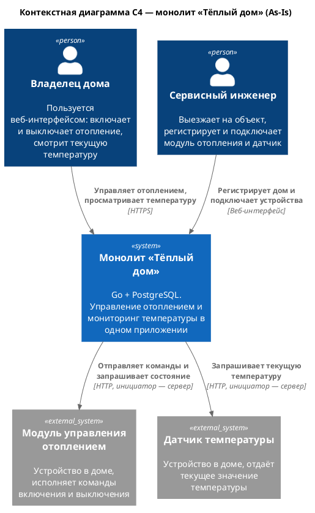

# Задание 2. Проектирование микросервисной архитектуры

В этом задании вам нужно предоставить только диаграммы в модели C4. Мы не просим вас отдельно описывать получившиеся микросервисы и то, как вы определили взаимодействия между компонентами To-Be системы. Если вы правильно подготовите диаграммы C4, они и так это покажут.

**Иерархия диаграмм**

- Уровень 1 — контекст: As-Is в Задании 1, To-Be ниже.
- Уровень 2 — контейнеры: одна диаграмма на систему, показывающая все контейнеры и их взаимодействие.
- Уровень 3 — компоненты: по одной диаграмме на каждый контейнер-микросервис.
- Уровень 4 — код: для критичного компонента Device Service.

**Контекст To-Be (уровень 1)**

Целевая экосистема как единая SaaS-платформа: пользователь, поддержка, устройства партнёров, камеры, провайдер уведомлений и платёжный провайдер.

- [Исходник PlantUML](schemas/c4/context-to-be.puml)
- [SVG-версия](schemas/c4/context-to-be.svg)

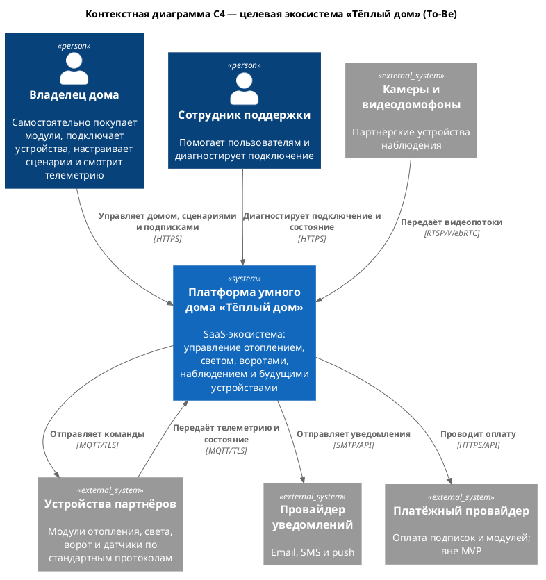

**Диаграмма контейнеров (Containers)**

Добавьте диаграмму.

Диаграмма показывает целевую платформу: веб-клиент, API Gateway, семь микросервисов, IoT Gateway для устройств, брокер событий и отдельные хранилища данных.

- [Исходник PlantUML](schemas/c4/container-to-be.puml)
- [SVG-версия](schemas/c4/container-to-be.svg)

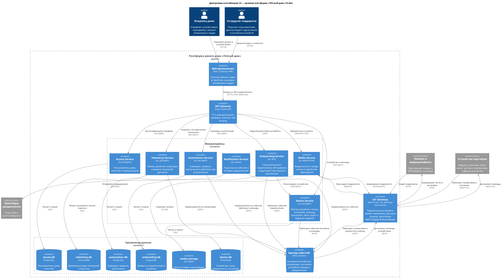

Ключевые решения:

- Устройства подключаются к IoT Gateway по MQTT и сами инициируют соединение, поэтому NAT и нестабильная связь не блокируют телеметрию.
- Отопление, свет, ворота и будущие модули обслуживает один Device Service с моделью типов и возможностей устройства; отдельный сервис на каждый тип устройства не создаётся.
- Видеонаблюдение вынесено в Media Service из-за bandwidth, WebRTC и отдельного хранилища записей.
- Синхронные запросы идут через API Gateway, а телеметрия, команды, события состояния и уведомления передаются асинхронно через брокер.
- У каждого сервиса своя база данных, поэтому схема и релизный цикл не связаны с соседними сервисами.

**Диаграмма компонентов (Components)**

Добавьте диаграмму для каждого из выделенных микросервисов.

**Device Service**

- [Исходник PlantUML](schemas/c4/component-device-service.puml)
- [SVG-версия](schemas/c4/component-device-service.svg)

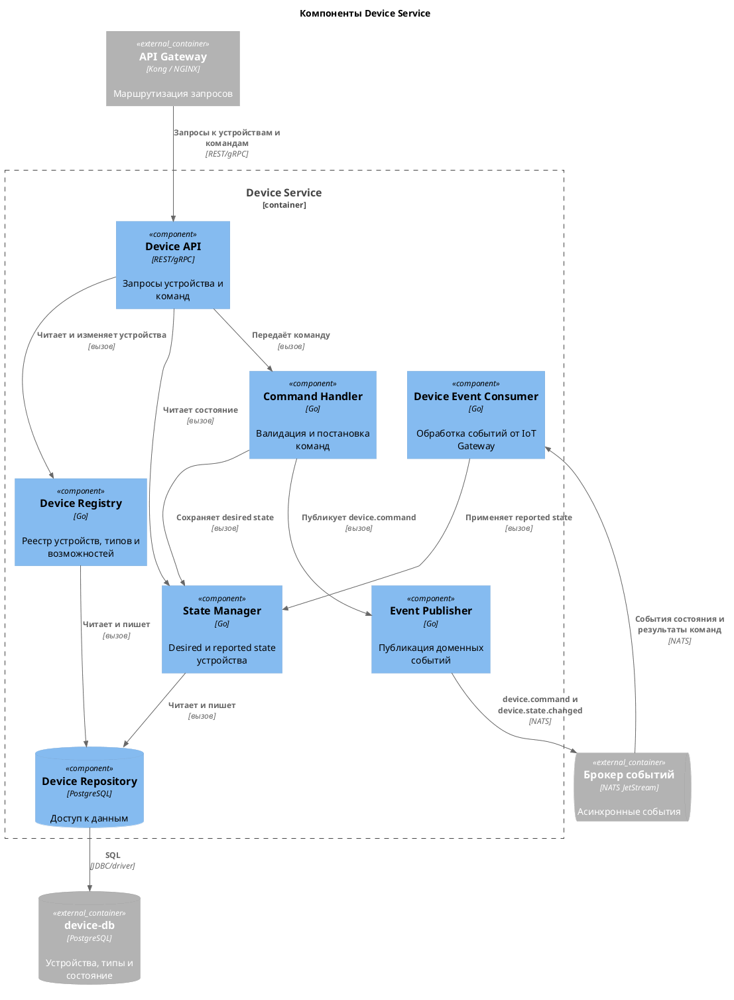

**Telemetry Service**

- [Исходник PlantUML](schemas/c4/component-telemetry-service.puml)
- [SVG-версия](schemas/c4/component-telemetry-service.svg)

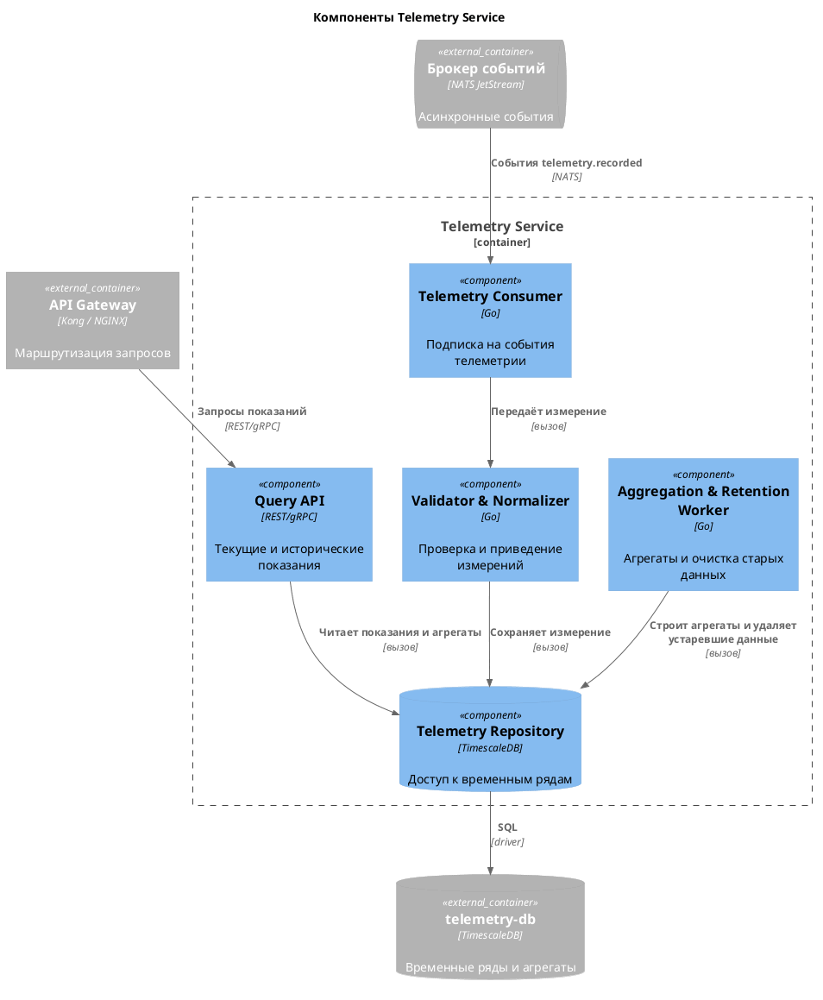

**Automation Service**

- [Исходник PlantUML](schemas/c4/component-automation-service.puml)
- [SVG-версия](schemas/c4/component-automation-service.svg)

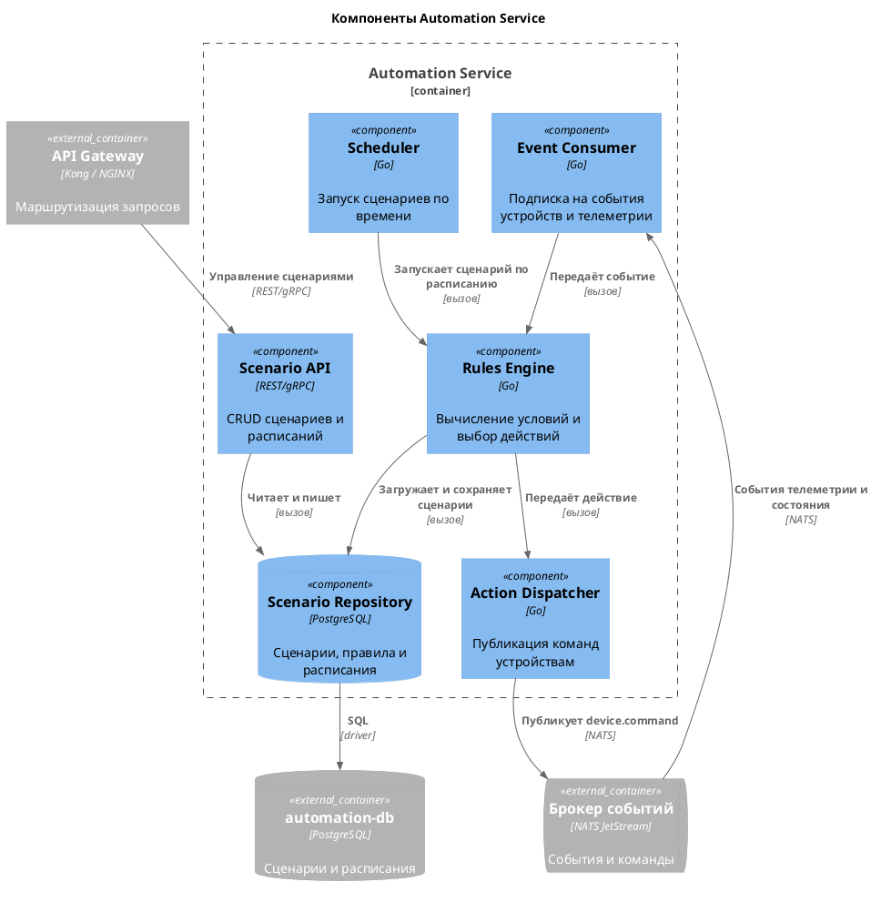

**Access Service**

- [Исходник PlantUML](schemas/c4/component-access-service.puml)
- [SVG-версия](schemas/c4/component-access-service.svg)

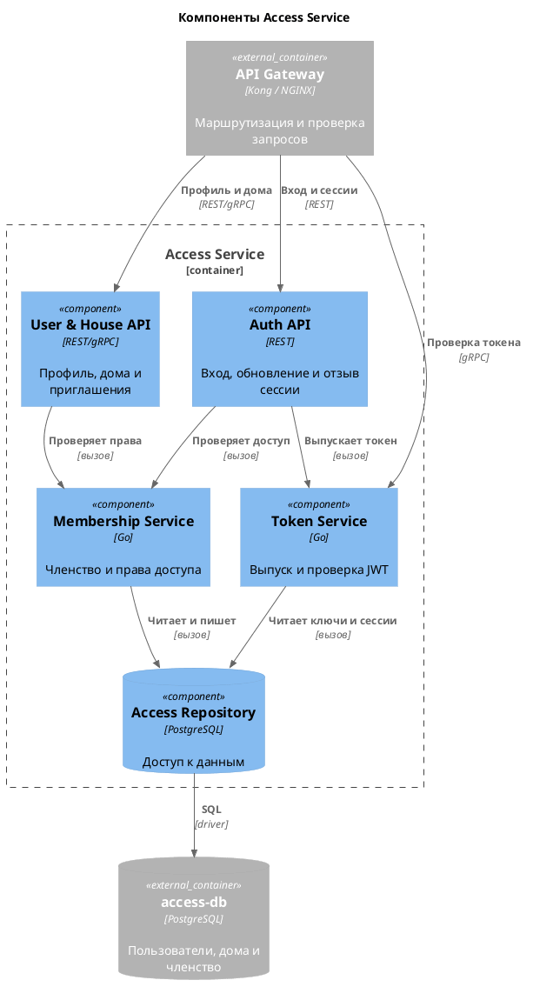

**Onboarding Service**

- [Исходник PlantUML](schemas/c4/component-onboarding-service.puml)
- [SVG-версия](schemas/c4/component-onboarding-service.svg)

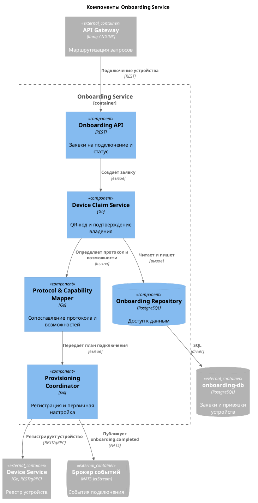

**Notification Service**

- [Исходник PlantUML](schemas/c4/component-notification-service.puml)
- [SVG-версия](schemas/c4/component-notification-service.svg)

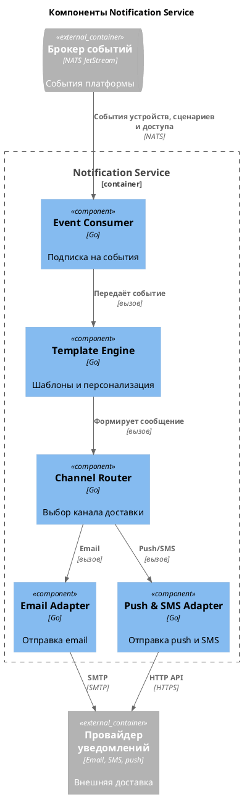

**Media Service**

- [Исходник PlantUML](schemas/c4/component-media-service.puml)
- [SVG-версия](schemas/c4/component-media-service.svg)

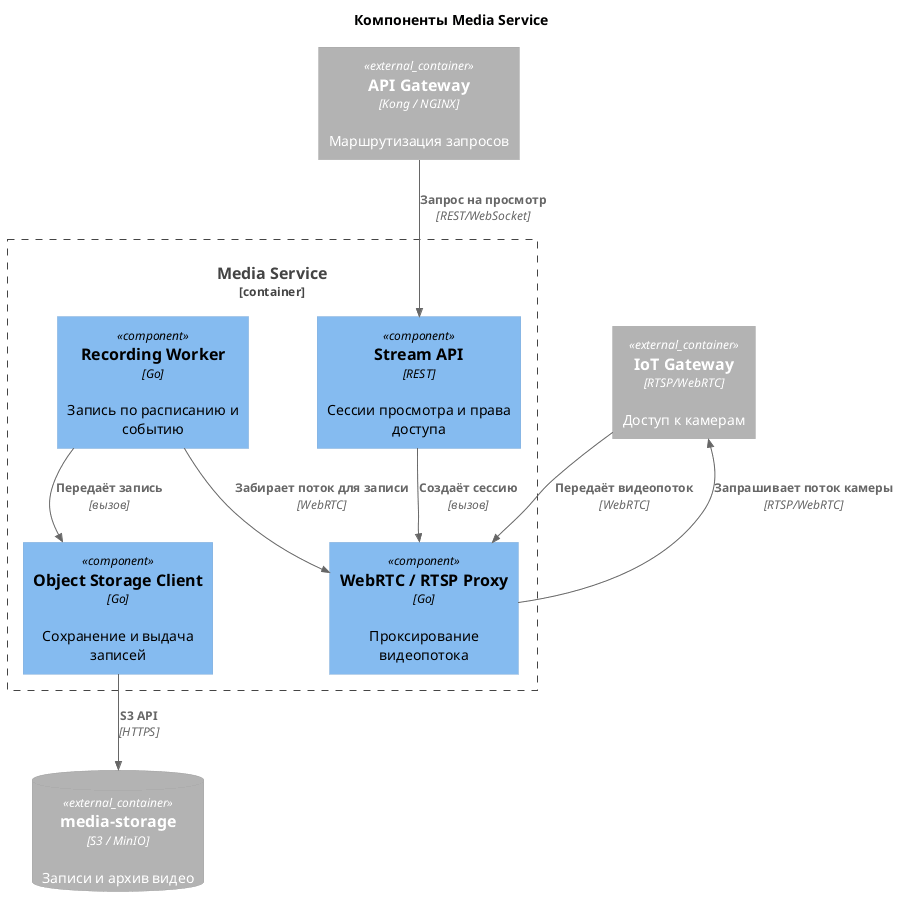

**Диаграмма кода (Code)**

Добавьте одну диаграмму или несколько.

**Модель агрегата Device**

- [Исходник PlantUML](schemas/c4/code-device-class.puml)
- [SVG-версия](schemas/c4/code-device-class.svg)

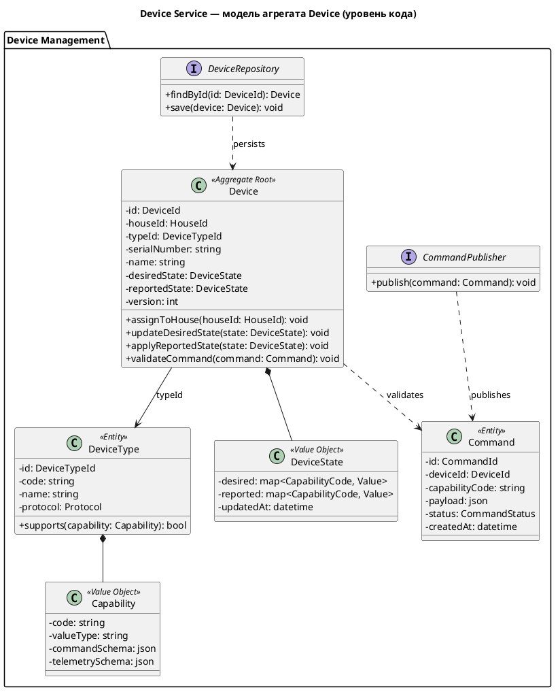

**Последовательность отправки команды устройству**

- [Исходник PlantUML](schemas/c4/code-command-sequence.puml)
- [SVG-версия](schemas/c4/code-command-sequence.svg)

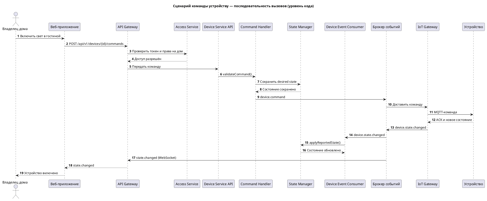

# Задание 3. Разработка ER-диаграммы

Добавьте сюда ER-диаграмму. Она должна отражать ключевые сущности системы, их атрибуты и тип связей между ними.

# Задание 4. Создание и документирование API

### 1. Тип API

Укажите, какой тип API вы будете использовать для взаимодействия микросервисов. Объясните своё решение.

### 2. Документация API

Здесь приложите ссылки на документацию API для микросервисов, которые вы спроектировали в первой части проектной работы. Для документирования используйте Swagger/OpenAPI или AsyncAPI.

# Задание 5. Работа с docker и docker-compose

Перейдите в apps.

Там находится приложение-монолит для работы с датчиками температуры. В README.md описано как запустить решение.

Вам нужно:

1) сделать простое приложение temperature-api на любом удобном для вас языке программирования, которое при запросе /temperature?location= будет отдавать рандомное значение температуры.

Locations - название комнаты, sensorId - идентификатор названия комнаты

```
	// If no location is provided, use a default based on sensor ID
	if location == "" {
		switch sensorID {
		case "1":
			location = "Living Room"
		case "2":
			location = "Bedroom"
		case "3":
			location = "Kitchen"
		default:
			location = "Unknown"
		}
	}

	// If no sensor ID is provided, generate one based on location
	if sensorID == "" {
		switch location {
		case "Living Room":
			sensorID = "1"
		case "Bedroom":
			sensorID = "2"
		case "Kitchen":
			sensorID = "3"
		default:
			sensorID = "0"
		}
	}
```

2) Приложение следует упаковать в Docker и добавить в docker-compose. Порт по умолчанию должен быть 8081

3) Кроме того для smart_home приложения требуется база данных - добавьте в docker-compose файл настройки для запуска postgres с указанием скрипта инициализации ./smart_home/init.sql

Для проверки можно использовать Postman коллекцию smarthome-api.postman_collection.json и вызвать:

- Create Sensor
- Get All Sensors

Должно при каждом вызове отображаться разное значение температуры

Ревьюер будет проверять точно так же.


# **Задание 6. Разработка MVP**

Необходимо создать новые микросервисы и обеспечить их интеграции с существующим монолитом для плавного перехода к микросервисной архитектуре. 

### **Что нужно сделать**

1. Создайте новые микросервисы для управления телеметрией и устройствами (с простейшей логикой), которые будут интегрированы с существующим монолитным приложением. Каждый микросервис на своем ООП языке.
2. Обеспечьте взаимодействие между микросервисами и монолитом (при желании с помощью брокера сообщений), чтобы постепенно перенести функциональность из монолита в микросервисы. 

В результате у вас должны быть созданы Dockerfiles и docker-compose для запуска микросервисов. 